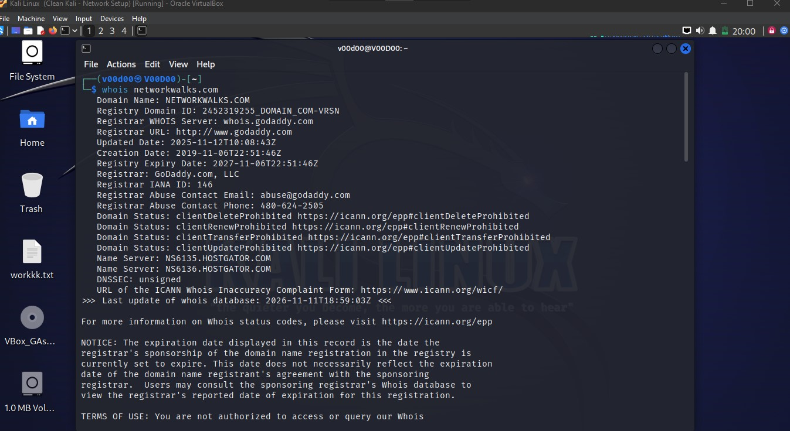
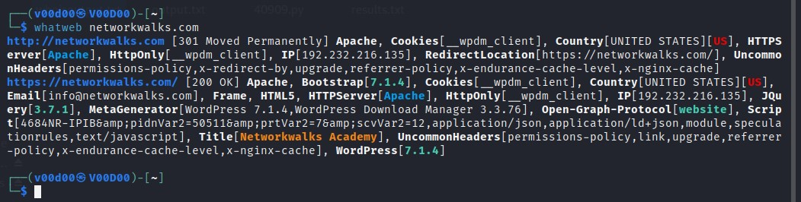
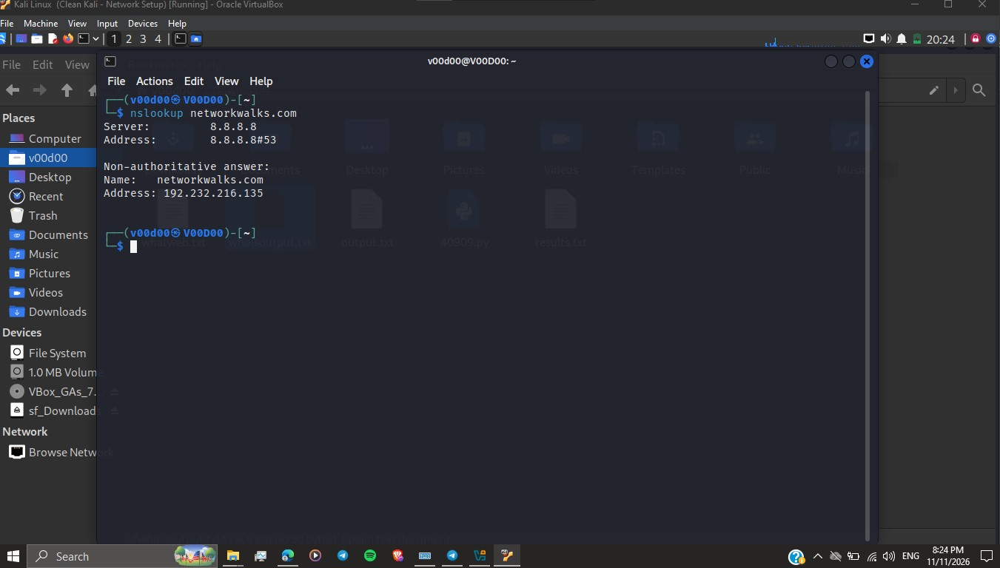
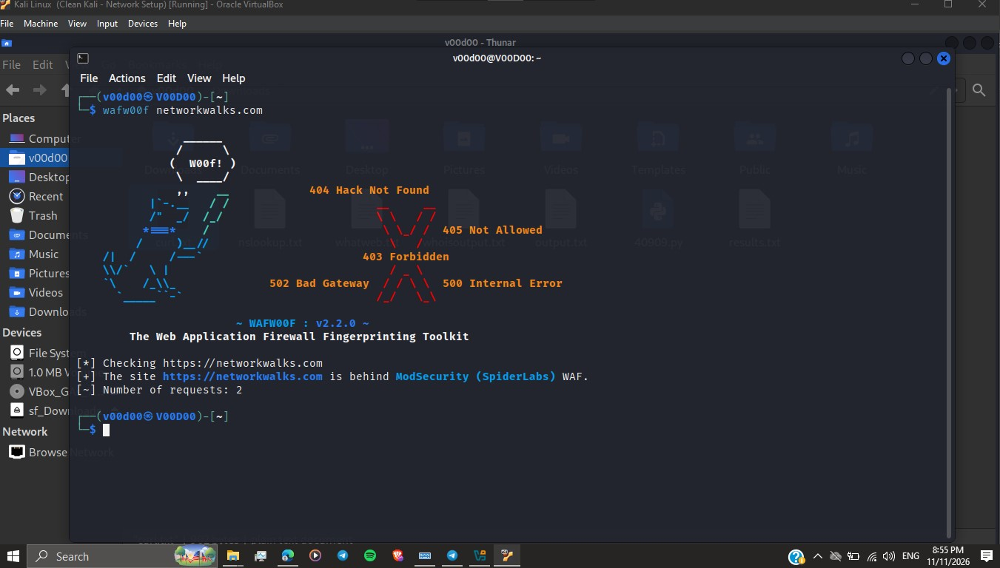
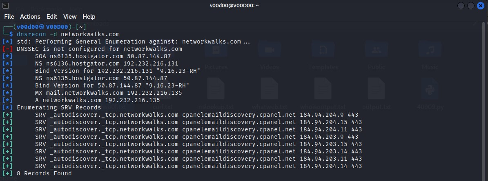
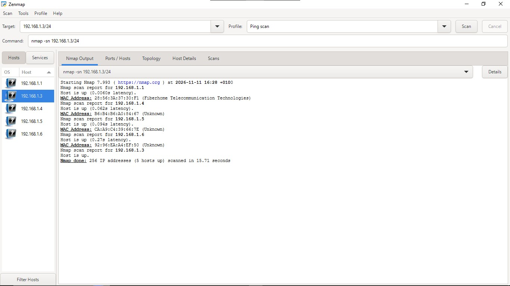
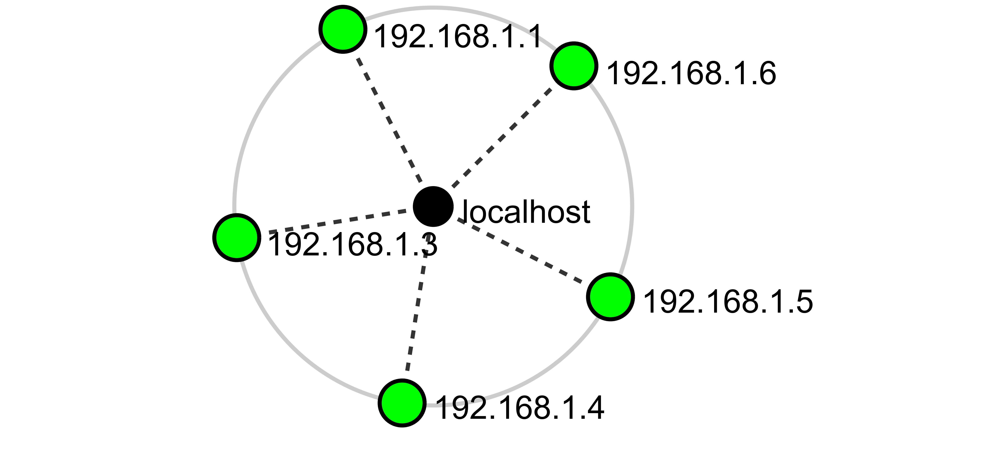

# NETWORKWALKS-B084-WK2-PENETRATION-TESTING
Authorized cybersecurity practical covering footprinting, reconnaissance, and network scanning using Kali Linux and Zenmap.
# Penetration Testing Report

## W2-PM1 & W2-PM5 — Multiple Kali Tools and Zenmap Scanning

**Author:** Afolabi Emmanuel Ibiyinka  
**Batch:** B084-Networkwalks  
**Date:** 13 November 2026  
**Assessment Type:** Authorized Penetration Testing / Network Reconnaissance  

---

## 1. Introduction

This report documents an authorized penetration testing and reconnaissance exercise carried out as part of the **W2-PM1 (Multiple Kali Tools)** and **W2-PM5 (Zenmap Scanning)** practical modules.

The assessment consisted of two main activities:

1. Reconnaissance and information gathering against `networkwalks.com`, for which written authorization had already been obtained.
2. Network discovery against my own local LAN using Zenmap.

The purpose of the exercise was to demonstrate the practical use of common reconnaissance, DNS enumeration, web technology fingerprinting, WAF detection, HTTP header inspection, and network scanning tools.

---

## 2. Scope and Authorization

### 2.1 Target 1 — Networkwalks

- **Target:** `networkwalks.com`
- **Authorization:** Written permission obtained before testing.
- **Activities:** Passive and low-impact reconnaissance, DNS enumeration, web fingerprinting, HTTP header inspection, and WAF detection.

### 2.2 Target 2 — Local LAN

- **Target:** My own local network.
- **Authorization:** Authorized because the network and devices were under my control.
- **Activity:** Host discovery using Zenmap/Nmap Ping Scan.

---

## 3. Tools Used

| Tool | Purpose |
|---|---|
| Kali Linux & Windows | Operating systems used for reconnaissance activities |
| WHOIS | Find domain registration details (owner, dates, name servers). |
| whatweb | Fingerprint web technologies (server, CMS, plugins, IP). |
| nslookup | Resolve the domain name to its IP address using DNS. |
| curl -I | Read the HTTP response headers of the website. |
| wafw00f | Detect whether a Web Application Firewall protects the site. |
| dnsrecon | Enumerate all DNS records (NS, MX, SPF, TXT, SRV). |
| Zenmap (Nmap GUI) | Scan the local subnet to find live hosts, IPs and MAC addresses. |
| Windows CMD | Local IP and MAC address identification. |

---

## 4. Methodology and Activities

### 4.1 Footprinting & Reconnaissance

I performed reconnaissance against the `networkwalks.com` domain using six Kali Linux tools: **WHOIS, WhatWeb, Nslookup, Curl, Wafw00f, and DNSRecon**. Each tool was used to collect a different type of information about the target.

First, I used **WHOIS** to obtain publicly available domain registration information and identify the domain's name servers. The result identified **GoDaddy.com, LLC** as the registrar, showed the domain creation date as **6 November 2019**, the displayed registry expiry date as **6 November 2027**, and the record update date as **12 November 2025**. The name servers identified were `NS6135.HOSTGATOR.COM` and `NS6136.HOSTGATOR.COM`. The output also showed several client-side transfer, renewal, and update prohibition statuses.

I then used **WhatWeb** to identify technologies used by the website. The result identified **Apache**, **WordPress 7.1.4**, **WordPress Download Manager 3.3.76**, and **jQuery 3.7.1**, among other application information. The server IP shown was `192.232.216.135`.

Using **nslookup**, I resolved the domain name to its IP address. The query was answered by Google's DNS server `8.8.8.8`, and the result identified `192.232.216.135`.

I used **curl -I** to inspect the HTTP response headers. The response returned **HTTP/2 200**, identified **Apache** as the server, and exposed additional application-related information. The response also exposed a link to the WordPress REST API endpoint `/wp-json/`.

Next, I used **wafw00f** to determine whether a Web Application Firewall was protecting the website. The result identified **ModSecurity (SpiderLabs)** as the WAF.

Finally, I used **DNSRecon** to enumerate DNS records. The results provided information relating to SOA, name servers, mail servers, A records, and SRV records. The output also reported that **DNSSEC was not configured** and exposed **BIND 9.16.23-RH** version information.

### 4.2 Network Scanning with Zenmap

For the second activity, I used **Windows CMD** to identify my local IP address and network configuration before using **Zenmap** to perform network discovery on my own local LAN.

I entered the local subnet into Zenmap and selected **Ping Scan** to identify active hosts. The scan was performed against the `192.168.1.0/24` subnet, and the Zenmap window showed the command:

```bash
nmap -sn 192.168.1.3/24
```

The scan covered **256 IP addresses** and identified **five hosts as up**:

- `192.168.1.1`
- `192.168.1.3`
- `192.168.1.4`
- `192.168.1.5`
- `192.168.1.6`

Zenmap also displayed MAC address information for the discovered hosts.

After completing the scan, the results provided a basic view of the active devices present on my local network at the time of testing.

---

## 5. Risk Analysis / Impact

The reconnaissance activities identified several pieces of information that could be useful during further authorized security testing.

### 5.1 Information Disclosure

WHOIS and DNS enumeration exposed domain registration, name server, mail server, and DNS infrastructure information. Such information can assist an attacker in understanding the target's external infrastructure.

### 5.2 Technology Fingerprinting

WhatWeb identified the web server and WordPress-related technologies. Knowing the technologies and versions used by a website can help an attacker research known vulnerabilities or identify likely attack surfaces.

### 5.3 HTTP Header and API Information

The HTTP response headers exposed information about the web server and WordPress environment. The presence of the `/wp-json/` endpoint also provides an identifiable application interface that could be examined during authorized security testing.

### 5.4 DNSSEC Configuration

DNSRecon reported that DNSSEC was not configured. Depending on the DNS infrastructure and other security controls in place, the absence of DNSSEC may increase exposure to certain DNS-related attacks.

### 5.5 Local Network Visibility

The Zenmap scan successfully identified five active hosts on the local subnet. This demonstrates how network discovery can reveal active devices and MAC address information within a local environment.

---

## 6. Recommendations

1. **Minimize information disclosure** in publicly accessible WHOIS, DNS, and HTTP responses where possible.
2. **Keep WordPress, plugins, libraries, and server software updated** to supported and secure versions.
3. **Review HTTP response headers** and remove unnecessary server or technology information where practical.
4. **Review the WordPress REST API exposure** and restrict unnecessary endpoints or information.
5. **Consider implementing DNSSEC** where supported and appropriate for the domain's DNS architecture.
6. **Maintain and properly configure the Web Application Firewall**, including regular review of its rules and logs.
7. **Segment internal networks** so that devices are not unnecessarily visible or reachable from one another.
8. **Monitor network devices and hosts** to identify unauthorized systems appearing on the local network.
9. **Conduct periodic authorized security assessments** to identify newly introduced weaknesses.

---

## 7. Conclusion

The practical assessment demonstrated the use of multiple Kali Linux reconnaissance tools and Zenmap for local network discovery.

The reconnaissance of `networkwalks.com` successfully identified domain registration information, DNS records, the target IP address, web technologies, HTTP response information, and the presence of ModSecurity. The local network scan also identified five active hosts within the tested subnet.

The exercise reinforced the importance of reconnaissance during penetration testing because publicly available information and basic network discovery can reveal useful details about an organization's infrastructure and potential attack surface.

All testing activities were performed within the stated authorized scope.

---

## 8. Evidence Collected

The assessment produced screenshots demonstrating the following activities:

| Evidence | Activity |
|---|---|
| WHOIS output | Domain registration and name server information |
| WhatWeb output | Web technology fingerprinting |
| nslookup output | Domain-to-IP resolution |
| curl -I output | HTTP response headers |
| wafw00f output | Web Application Firewall detection |
| DNSRecon output | DNS record enumeration |
| Zenmap output | Local network host discovery |

### Evidence Images

Evidence/
├── whois.jpg
├── Whatweb.jpg
├── nslookup.jpg
├── curl.jpg
├── waf.jpg
├── dns.jpg
└── Zenmap.jpg
└── NetworkTopology.jpg

















---

## 9. Ethical and Legal Considerations

This project was conducted for educational and authorized security testing purposes.

- `networkwalks.com` was tested only after written permission had been obtained.
- The local network scan was performed against my own authorized LAN.
- No unauthorized exploitation or destructive activity was performed.
- Testing was limited to the defined scope.

---

## Author

**Afolabi Emmanuel Ibiyinka**  
**Batch:** B084-Networkwalks
